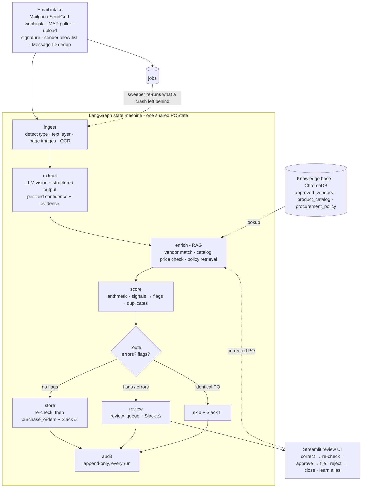
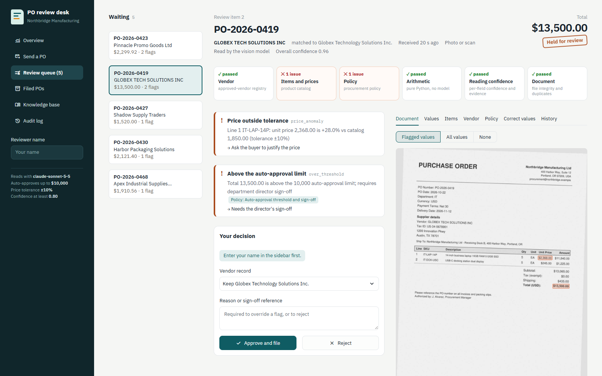
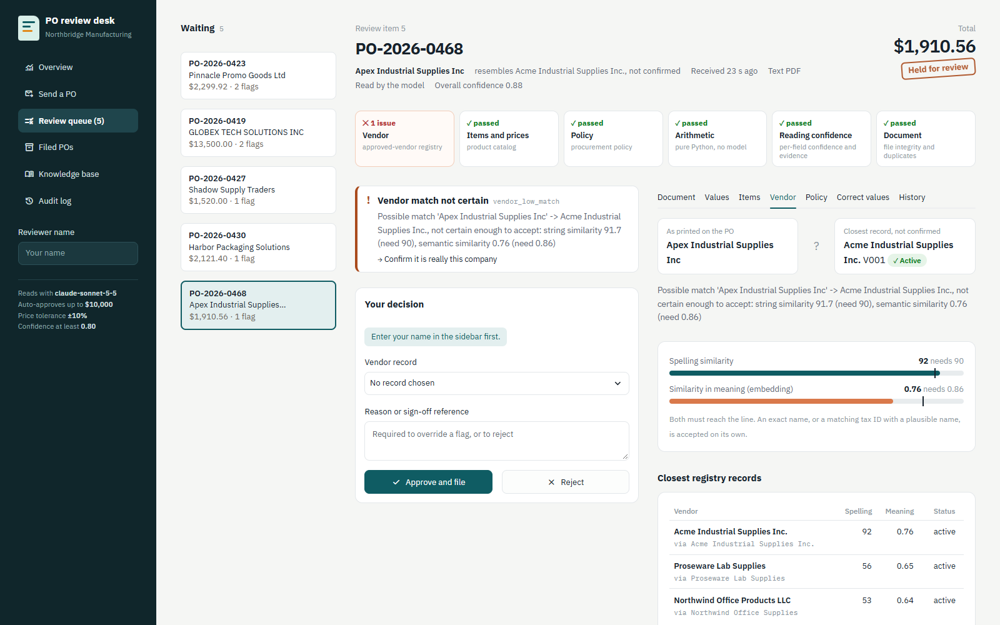
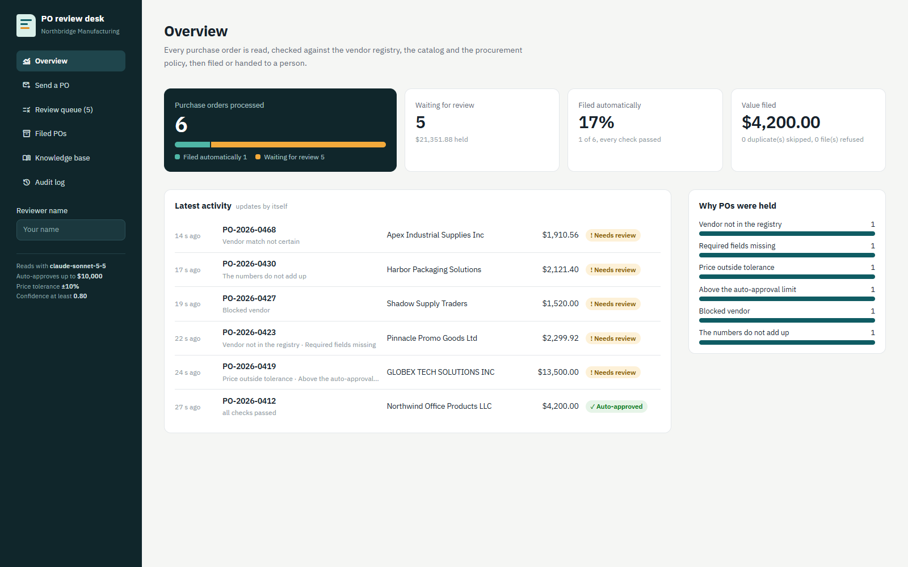

# PO Intake & Validation Agent

**A procurement agent that receives purchase orders by email, extracts them into structured data, validates them against an internal knowledge base (approved vendors, product catalog, procurement policy), and either files them automatically or routes them to a human reviewer with the specific reasons.** The decision is deterministic and auditable: a PO is auto-filed only when *every* check was performed and passed. The governing principle is **fail toward a human**: an error, a doubt or a check that could not be run all send the PO to the review queue with a stated reason. Nothing is silently dropped, and nothing questionable is silently approved.

Code-first: **LangGraph** state machine · **FastAPI** webhook · Claude / GPT-4o vision + structured output · **ChromaDB** + rapidfuzz hybrid retrieval · SQLite (SQLModel) · Streamlit review UI · Slack · Docker.

---

## Architecture



| Stage | Module | What it does |
|---|---|---|
| 1. Email intake | [app/intake/](app/intake/) | Webhook (Mailgun HMAC + replay protection, SendGrid/generic shared secret), IMAP fallback, sender allow-list, atomic Message-ID dedup, type/size/logo checks, raw file persisted, CSV batches split into one job per PO, crash recovery |
| 2. Ingestion | [app/ingestion/loaders.py](app/ingestion/loaders.py) | Text / scanned / **mixed** PDF, image, multi-page TIFF and CSV detection; text layer, page renders, EXIF rotation, optional Tesseract OCR; locked/corrupt/empty files raise coded errors |
| 3. Extraction | [app/extraction/](app/extraction/) | `PurchaseOrder` with per-field **confidence + evidence**; native JSON-schema output + Pydantic + bounded re-prompt; deterministic CSV mapping; offline heuristic fallback; every value **traced back to the document** |
| 4. RAG enrichment | [app/rag/](app/rag/) | Vendor match (fuzzy **and** semantic must agree), SKU/description match + price tolerance, policy clause retrieval → limits read from the clause text → rule checks + optional LLM review |
| 5. Scoring | [app/scoring.py](app/scoring.py) | Deterministic: independent signals → flags with human-readable reasons |
| 6. Routing | [app/graph/](app/graph/) | Conditional edge `store` / `review` / `skip`; every node is wrapped fail-safe |
| 7. Actions | [app/actions/](app/actions/) | SQLModel writes, review queue with corrections, Slack, append-only audit (DB triggers **and** JSONL), optional Google Sheets mirror |

### The review desk

| | |
|---|---|
|  | **A held PO.** Why it was held in plain words, the six checks, and the flagged price and total marked on the photographed document itself. |
|  | **A lookalike vendor.** Spelled 92% like an approved one, but the embedding disagrees. The match is shown as unconfirmed and nothing is preselected. |
|  | **Overview.** Live activity, what was filed automatically, and why the rest was held. |

Screenshots are from a live run on Claude Sonnet 5.5.

---

## Why purchase orders, and why RAG is not decoration

A PO has real structure (header, repeating line items, totals, arithmetic) and real stakes: a wrong vendor, a price 28% over contract, or spend over someone's approval limit must be caught **before** booking. "Approve this spend" is already a human decision, so human-in-the-loop models a workflow that exists.

Two questions need evidence, not assertion.

**1. Does the knowledge base change decisions?** `python scripts/ablation.py` runs the same files with the KB off, with lexical matching only, and with hybrid RAG:

```
document                    | KB off                   | KB on, no embeddings               | hybrid RAG
01_clean_northwind.pdf      | AUTO-APPROVE             | AUTO-APPROVE                       | AUTO-APPROVE
03_unknown_vendor.csv       | review: missing_fields   | review: vendor_unknown, missing_…  | review: vendor_unknown, missing_fields
04_acme_alias_twocol.pdf    | AUTO-APPROVE             | AUTO-APPROVE                       | AUTO-APPROVE
05_blocked_vendor.pdf       | AUTO-APPROVE  <-- wrong  | review: vendor_blocked             | review: vendor_blocked
06_math_error.pdf           | review: math_mismatch    | review: math_mismatch              | review: math_mismatch
07_bad_terms.pdf            | AUTO-APPROVE  <-- wrong  | review: noncompliant_terms         | review: noncompliant_terms
09_no_sku_paraphrased.csv   | AUTO-APPROVE (unchecked) | review: unknown_item               | AUTO-APPROVE (items matched, prices checked)
10_lookalike_vendor.pdf     | AUTO-APPROVE  <-- wrong  | review: vendor_low_match           | review: vendor_low_match
```

Offline run with local bge-small embeddings. Turn the KB off and a blocked vendor, non-compliant terms and an unvetted lookalike vendor are all filed. The scan (`02`) is left out here because offline OCR can't read its line items; its ablation is covered by `test_ablation_rag_off_lets_bad_po_through`.

**2. Do the embeddings change anything a string match would not?** `python scripts/eval_retrieval.py` measures matching on [75 labelled cases](data/eval/retrieval_cases.csv): paraphrased items, misspelled vendors, lookalikes that must *not* match, and policy questions. Thresholds were chosen on the `dev` rows only; these are the held-out `test` rows:

| Held-out task | Plain fuzzy match | Hybrid | Wrong accepts (fuzzy → hybrid) |
|---|---|---|---|
| Item description → SKU | 11 / 24 | **22 / 24** | 0 → 0 |
| Vendor name → registry record | 8 / 11 | 8 / 11 | 0 → 0 |
| Question → policy clause (lexical retrieval) | 2 / 6 | **6 / 6** | n/a |

So embeddings clearly help with items and policy retrieval. For vendors they do **not** add accuracy on the held-out rows; they are there for safety. On the `dev` rows plain fuzzy accepts one wrong vendor (9/10) and hybrid accepts none (10/10).

Hybrid misses all fail in the safe direction: "no match", which goes to a human. The set is small and hand-written; it shows the direction, not a production error rate.

The vendor case that decided the design (a `dev` row, so it illustrates the rule rather than validating it): **"Apex Industrial Supplies Inc" is 92% string-similar to the approved vendor "Acme Industrial Supplies Inc."**, so fuzzy matching alone would auto-approve a company nobody has vetted. Its embedding similarity is 0.76, while every genuine spelling variant in the set scores 0.92 or more. Requiring both signals to agree sends it to review (`10_lookalike_vendor.pdf`).

---

## The three demo files

Generated by `python scripts/make_samples.py` into [data/samples/](data/samples/) (ground truth in `labels/`).

| # | File | Designed to | Outcome |
|---|---|---|---|
| 1 | `01_clean_northwind.pdf`: clean text PDF | Known active vendor, catalog SKUs, prices in tolerance, total **$4,200**, math correct | **Auto-approved**: filed in `purchase_orders`, Slack ✅ |
| 2 | `02_scanned_globex.jpg`: rotated, noisy, blurred photo of a PO | Vendor printed as alias *"GLOBEX TECH SOLUTIONS INC"*; laptops at $2,368 vs catalog $1,850 (**+28%**); total **$13,500** | **Review**: `price_anomaly`, `over_threshold` |
| 3 | `03_unknown_vendor.csv`: CSV | Vendor *Pinnacle Promo Goods Ltd* absent from the registry; delivery date blank | **Review**: `vendor_unknown`, `missing_fields` |

More labelled files: `04` alias vendor + two-column header + lines split across pages (auto-approve) · `05` blocked vendor · `06` total doesn't add up · `07` Net 90 terms · `08` CSV batch with two POs · `09` no SKUs, items described in the buyer's own words (auto-approve, only possible with embeddings) · `10` lookalike vendor · `11` a negative line that pulls $18,500 of laptops under the limit · `edge_corrupt.pdf`, `edge_locked.pdf`, `edge_unsupported.zip`.

---

## Quick start

### Docker (whole system)

```bash
python scripts/init_env.py      # creates .env with generated secrets (standard library only)
# put your key after ANTHROPIC_API_KEY= in .env   (or LLM_PROVIDER=openai + OPENAI_API_KEY)
docker compose up --build       # API :8000, review UI :8501 (bound to localhost)
docker compose --profile imap up   # also start the Gmail / IMAP poller
```

The API builds the knowledge base on first start and rebuilds it whenever the files in `data/seed/` change. The embedding model is downloaded once into `storage/models`.

### Local (Python 3.11)

```bash
python -m venv .venv && .venv\Scripts\activate         # Windows   (source .venv/bin/activate on macOS/Linux)
pip install -e ".[dev]" -c constraints.txt
python scripts/init_env.py
python -m app.cli kb build                              # 3 Chroma collections
python -m app.cli check                                 # is everything configured working? (free)
uvicorn app.main:app --port 8000                        # API + webhook
streamlit run review_ui/app.py                          # review UI on :8501
pytest                                                  # 221 tests, fully offline
```

No API key? Set `LLM_PROVIDER=heuristic`. Text PDFs and CSVs then run end to end with a deterministic parser; scans go to review.

### Sending a test email

0. **From the browser:** open http://localhost:8501, page *Send a PO*. It posts a signed email to the webhook with one click (demo documents or your own file) and shows the agent working live.
1. **Signed webhook, no domain needed:** `python scripts/simulate_webhook.py data/samples/01_clean_northwind.pdf` posts a correctly HMAC-signed Mailgun payload. Add `--bad-signature` to see the 401, or re-use `--message-id` to see dedup. In Docker: `docker compose exec api python scripts/simulate_webhook.py data/samples/01_clean_northwind.pdf`.
2. **Real email → Gmail (IMAP):** see [Connecting Gmail](#connecting-gmail). Then just send the PO to that address from any mail client.
3. **Real email → webhook:** point a Mailgun route at `https://<tunnel>/webhook/inbound-email?provider=mailgun` (e.g. `ngrok http 8000`). For SendGrid Inbound Parse set `WEBHOOK_PROVIDER=sendgrid` and use `…?provider=sendgrid&token=<WEBHOOK_SHARED_SECRET>`.

Or skip email: `python -m app.cli process data/samples/01_clean_northwind.pdf`.

### Connecting Gmail

1. Use a dedicated Gmail account, turn on 2-Step Verification and create an [App Password](https://myaccount.google.com/apppasswords).
2. In `.env`: `IMAP_USER`, `IMAP_PASSWORD` (the App Password) and `ALLOWED_SENDERS` (the addresses that send POs). Optionally `IMAP_FOLDER=<Gmail label>`.
3. `docker compose exec api python -m app.cli check` verifies the sign-in, then `docker compose --profile imap up -d` starts the poller.

The poller is safe on a mailbox that also receives other mail: it refuses to read a whole inbox without a sender list, looks at headers first, never downloads or marks mail from anyone else, only considers recent unread messages (capped per poll), and refuses senders the mail server reported as forged (SPF/DKIM/DMARC).

### API

Everything except the webhook and `/health` requires the `X-API-Key` header (`API_KEY` in `.env`). If no key is configured those endpoints are **closed**, not open: the webhook is meant to be exposed through a tunnel, and they share its port.

| Endpoint | Purpose |
|---|---|
| `POST /webhook/inbound-email?provider=mailgun` | Verify → persist → dedup → enqueue → 200 fast (503 + `Retry-After` if the mail could not be stored safely) |
| `POST /process` | Direct upload, runs synchronously, returns decisions |
| `GET /jobs`, `GET /jobs/{job_id}` | Job status + where it landed |
| `GET /purchase-orders`, `GET /purchase-orders/{id}` | Filed POs + line items with catalog price and deviation |
| `GET /review-queue?status=pending_review\|approved\|rejected\|all` | Queue with flags, reasons, confidences |
| `POST /review-queue/{id}/correct` · `/reprocess` | Fix misread values / extract again; every check re-runs |
| `POST /review-queue/{id}/approve` · `/reject` | Same rules as the UI |
| `GET /audit` · `POST /kb/rebuild` · `GET /health` | Audit trail · ops |

---

## Extraction (schema & output contract)

[app/extraction/schema.py](app/extraction/schema.py): header fields are `Confidenced(value, confidence, evidence)`, plus `line_items[]` (each with confidence + evidence) and `subtotal/tax/shipping/total` with `totals_confidence`. Agent-owned fields (`overall_confidence`, warnings, method) are never shown to the model.

- **Empty over guesses.** The [prompt](app/extraction/prompts.py) demands an empty value with low confidence for anything not clearly printed, and forbids computing missing values. A confident wrong vendor would defeat the validation layer.
- **Enforced structure.** Pydantic → strict JSON schema → provider-native structured output, then Pydantic validation; invalid output is re-prompted with the error (bounded), then goes to review. Claude allows at most 16 union-typed fields per schema, and every nullable field is one, so optional *strings* are sent as plain strings (`""` = absent) and only optional numbers stay nullable.
- **Anti-hallucination, two links** ([verify.py](app/extraction/verify.py)). The evidence must occur in the document **and** must contain the value it is offered for; dates, amounts and IDs are compared by meaning ("Oct 20, 2026" supports `2026-10-20`). Line quantities, prices and SKUs must appear in the text. Scans are checked against OCR for vendor, PO number and total. A value that can't be traced loses half its confidence, which forces review.
- **Vision path.** Scans go to the model as page images. A PDF that mixes text pages and scanned pages sends exactly the scanned ones, so half a PO can't go missing.
- **Documents are data.** The prompt tells the model to ignore instructions inside a PO. More importantly, the model has no power to approve: a manipulated extraction still has to survive the deterministic checks.
- **Critical fields:** `vendor_name`, `total`, `line_items`, plus `po_number` (the dedup key) and `currency` (the threshold is meaningless without it).

## RAG knowledge base

Three Chroma collections built from [data/seed/](data/seed/). The seed files are the source of truth; Chroma is the index, stamped with the embedder *and* a fingerprint of the seed files, so it can't go stale. Embeddings: local **bge-small-en-v1.5** via fastembed (no key, no torch) or OpenAI `text-embedding-3-small`.

| Collection | Contents | Question it answers |
|---|---|---|
| `approved_vendors` | 15 vendors, one document per **name or alias** (49 names), status (V015 is **blocked**), tax ID, terms | Is this a real, active vendor, and which record is it? |
| `product_catalog` | 30 SKUs with description, unit, standard price | Which product is this line, and is its price within tolerance? |
| `procurement_policy` | [policy.md](data/seed/policy.md) chunked per clause | Does the PO comply, and does it need sign-off? |

- **Vendors** ([vendors.py](app/rag/vendors.py)). Accepted: an exact name/alias, a matching tax ID with a plausible name, or fuzzy ≥ 90 **and** semantic ≥ 0.86. One convincing signal → `vendor_low_match` with the suggested record; neither → `vendor_unknown`. Two vendors within 5 points → `vendor_ambiguous`.
- **Items** ([catalog.py](app/rag/catalog.py)). Exact SKU, cross-checked against the description (`sku_mismatch`). Without a SKU, lexical or semantic similarity may match, each behind a threshold *and* a margin over the runner-up: "Copy paper" fits two SKUs, so it fits neither.
- **Policy** ([policy.py](app/rag/policy.py), [rules.py](app/rag/rules.py)). Queries are built from the PO's situation; the approval limit, spend limit, allowed terms, price tolerance, split window and currency are **read out of the retrieved clause text**. Edit `policy.md` and the decisions follow. `.env` values act as caps and the stricter of the two wins, so neither can silently loosen the other. If retrieval misses a clause, the full policy text backs it up, so a limit never depends on retrieval quality; a rule that disappears from the text sends every PO to review. With an LLM configured, the model also reads the clauses and may **add** findings, never remove one; citations of clauses that weren't retrieved are discarded, and if the review fails that is itself a flag.
- **Spend splitting.** Same vendor, same item, within the policy's 7 days: the POs are added up against the limit (`possible_po_split`).

With the vector store down, matching degrades to lexical **and becomes stricter**: only exact vendor names and tax IDs are accepted.

## Scoring & decision policy

[app/scoring.py](app/scoring.py): deterministic, every flag with a reason. A check that could not be performed is a flag too; "nothing to check" is not "checked and fine".

| Signal | Flags |
|---|---|
| Extraction | `low_extraction_confidence`, `missing_fields`, `incomplete_lines` |
| Vendor (RAG) | `vendor_unknown`, `vendor_blocked`, `vendor_ambiguous`, `vendor_low_match`, `vendor_not_verified`, `vendor_tax_id_mismatch` |
| Items & prices (RAG) | `price_anomaly`, `unknown_item`, `unit_mismatch`, `sku_mismatch` |
| Policy (RAG) | `over_threshold`, `exceeds_po_limit`, `noncompliant_terms`, `non_base_currency`, `possible_po_split`, `policy_violation`, `policy_rule_missing`, `policy_review_unavailable` |
| Arithmetic (pure Python) | `math_mismatch`, `math_unverified`, `invalid_amount` (zero, negative, not finite) |
| Document | `po_number_conflict`, `multiple_pos_in_document`, `malformed_csv`, `truncated_document`, `unread_pages` |

## Human-in-the-loop

[review.py](app/actions/review.py) holds the rules, so the UI and the API enforce the same ones. The [review desk](review_ui/) has six pages: overview, send a PO, review queue, filed POs, knowledge base and audit log.

- **See why.** Each flag has a plain title, the reason, the cited policy clause and what to do about it. Flagged values are marked on the source document: PDFs by text search, scans through OCR word positions. A check that had nothing to check shows "not possible", never "passed".

- **Correct.** The reviewer fixes misread values next to the source document, and *every check runs again*, so a correction can clear flags or raise new ones. The original extraction is kept, and the change is audit-logged with before/after values. Unreadable documents can be keyed in by hand. **Reprocess** extracts the original file again, e.g. after an LLM outage.
- **Approve** needs an *active* registry vendor (looked up at that moment), all critical fields, and a written note if any flag is being overridden. A blocked vendor can't be approved or relabelled, and an *uncertain* match is never adopted by default: the reviewer has to name the record. The claim, the filed PO and the learned alias are one transaction; of two simultaneous clicks one wins.
- **Amendments.** Same PO number with different content is never dropped: the reviewer sees the differences and can replace the filed PO, which becomes `superseded`.
- **Vendor alias learning.** A confirmed spelling is stored and indexed; it is refused if it already belongs to another vendor.

## Handling things going wrong

Every node runs inside `@safe_node`: an exception becomes an entry in `state["errors"]`, and `route` turns any error into a review flag. The router refuses to auto-approve if `route` itself failed. **The worst case for a weird input is that a human looks at it.** Regression tests for all of this: [test_failsafe.py](tests/test_failsafe.py), [test_routing.py](tests/test_routing.py), [test_intake.py](tests/test_intake.py).

| What goes wrong | What happens |
|---|---|
| Corrupt / locked / empty file, scan with no vision model | coded flag → review |
| Low-quality scan, invalid JSON, refusal, truncation, rate limit, timeout | backoff / bounded re-prompt → otherwise review |
| Hallucinated value, or evidence that doesn't contain it | confidence cut → review |
| Scanned page inside a text PDF, >20 pages, several POs in one file, shifted CSV columns | page sent to vision, or flagged → review |
| Unknown / blocked / lookalike vendor, odd price, wrong unit, missing price, negative amount | specific flag → review |
| A validation step throws, or the LLM policy review is down | that failure is a flag; the other checks still run |
| Filing fails, or a second PO slips in between scoring and filing | re-checked under a lock + `UNIQUE(po_key)` → review |
| **Review queue itself can't be written** | 3 tries → dead-letter file + Slack alarm → job retried → after 3 attempts handed to a human |
| **Crash after the email was accepted** | job stays in the DB; the sweeper re-runs it (atomic claim, never twice) |
| **Crash or disk error during intake** | claim released; provider gets 503 and retries; the redelivery takes over without duplicating jobs |
| Duplicate email / identical PO re-sent | skipped, audited, announced in Slack |
| Same PO number, different content | `po_number_conflict` → review, with the differences |
| Spoofed, replayed or stale webhook; caller picking a weaker provider; placeholder secret | 401 + audited |
| Unsupported / oversize attachment, signature logo, no attachment, sender not allowed | rejected with a logged reason; other attachments still processed |
| Slack / Sheets down | logged; decision unaffected |
| Audit tampering | SQLite triggers abort UPDATE/DELETE |

## Evaluation

`python scripts/eval_extraction.py [-v] [--provider anthropic|openai|heuristic]` scores field accuracy (headers, totals, per-line SKU/qty/price/total) and routing accuracy (decision + **exact** flag set) against the 12 labelled POs, on a throwaway database.

| Extractor | Field accuracy | Routing (exact flags) | Cost per run |
|---|---|---|---|
| **Claude Sonnet 5.5**, three consecutive runs | **272 / 272**, all three | **12 / 12**, all three | about $0.18 (19 calls) |
| Offline heuristic + Tesseract, no key | 263 / 272 (96.7%) | 11 / 12 | 0 |

The offline miss is the photographed PO (`02`): OCR can't recover its line items, so it goes to review without `price_anomaly`. The vision model reads it completely, which is why the LLM is the primary extractor.

Before those runs, the eval caught a real bug: routing was 11/12 because the LLM policy reviewer was not told about vendor and price flags and reported the blocked vendor a second time as `policy_violation`. It is fixed and has a regression test.

Read these numbers as a regression check, not as an estimate of real-world accuracy: the 12 POs are synthetic, were available during development, and 5 of them are CSVs that don't need the model.

## Configuration

Everything is in [.env.example](.env.example). Default model `claude-sonnet-5-5` at `effort=medium` with Anthropic's server-side refusal fallback (`ANTHROPIC_SERVER_FALLBACK=false` disables it); `LLM_PROVIDER=openai` uses `gpt-4o`. Exact dependency versions are in [constraints.txt](constraints.txt), used by the Dockerfile and [CI](.github/workflows/ci.yml).

Observability: structured JSON logs per node (job id, duration, outcome), token usage per LLM call, and a per-run `trace` in the audit record.

## Design decisions & trade-offs

- **Deterministic scorer, not "ask the LLM if it's confident".** Every decision has a stated, reproducible reason. The LLM reads messy documents and policy prose, and can only make the outcome *stricter*.
- **Two matching signals that must agree.** Embeddings find the right record despite wording; string similarity keeps them precise. Either alone has a failure that costs money.
- **Policy text is the configuration.** The limits the agent enforces are the ones a policy owner can read and edit, with `.env` as a safety cap.
- **Native structured output instead of `instructor`.** Both providers enforce JSON schemas natively; Pydantic + a bounded re-prompt keep the guarantee without the dependency.
- **CSV gets a deterministic path.** A recognised column layout doesn't need an LLM (cheaper, exact). Unrecognised layouts fall through to it.
- **In-process jobs, durable state.** `BackgroundTasks` plus a job table and a sweeper: no broker to run, and nothing lost on a crash. `run_job()` drops into Celery/RQ unchanged.
- **Stretch items built:** extraction and retrieval eval harnesses, alias learning, reprocess and correction in the UI, structured logs, optional Google Sheets mirror, [n8n export](workflows/n8n_intake.json) (set `WEBHOOK_EXTRA_PROVIDERS=generic`).

**Known limits.** One API process (the webhook replay cache, filing lock and startup recovery are per process; `UNIQUE` constraints still hold across processes). The audit triggers are SQLite-only, and Postgres is untested. Reviewer names are self-declared: real use needs SSO. Non-USD POs are flagged rather than converted. Values are located on the document for display by searching for them; the extraction itself stores a text snippet, not coordinates. Local file storage, no S3.

## Repository layout

```
app/
  main.py               FastAPI app + /webhook/inbound-email + authenticated API
  config.py · cli.py    pydantic-settings (all thresholds) · kb build, process, imap
  doctor.py             configuration check
  llm.py                provider-agnostic structured output (Claude / OpenAI), vision, retries
  intake/               common.py (dedup, jobs, recovery, CSV split) · webhook.py (signatures) · imap_poller.py · simulate.py · mailer.py
  ingestion/loaders.py  PDF / image / CSV detection, text, page images, OCR
  extraction/           schema.py · prompts.py · extractor.py (LLM / CSV / heuristic) · verify.py (grounding)
  rag/                  store.py · ingest_kb.py · vendors.py · catalog.py · policy.py · rules.py (limits from text)
  scoring.py            arithmetic + signals + decide()
  graph/                state.py · nodes.py (fail-safe nodes) · build.py (LangGraph wiring)
  actions/              store.py · review.py (HITL rules) · notify.py · audit.py · sheets.py
  models.py · db.py     SQLModel tables, append-only triggers
review_ui/              Streamlit review desk: app.py (shell) · pages.py · document.py (marks values) · data.py · theme.py
data/seed/ · data/samples/ · data/eval/     knowledge base · demo + labelled files · retrieval cases
scripts/                init_env · make_samples · simulate_webhook · send_test_email · eval_extraction · eval_retrieval · ablation
workflows/              n8n_intake.json
tests/                  221 tests, offline
```
