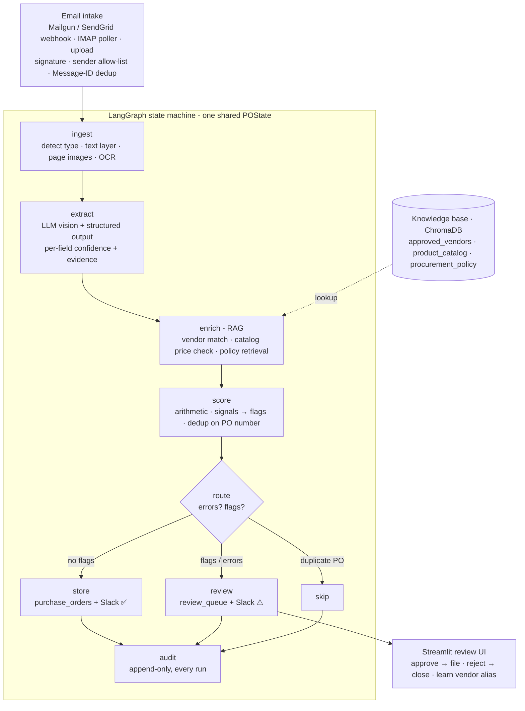

# PO Intake & Validation Agent

**A procurement agent that receives purchase orders by email, extracts them into structured data, validates them against an internal knowledge base (approved vendors, product catalog, procurement policy), and either files them automatically or routes them to a human reviewer with the specific reasons.** The decision is deterministic and auditable: a PO is auto-filed only when *every* check passes. The governing principle is **fail toward a human**. Any error, uncertainty or policy issue sends the PO to the review queue with a stated reason. Nothing crashes the pipeline, nothing is silently dropped, and nothing questionable is silently auto-approved.

Code-first: **LangGraph** state machine · **FastAPI** webhook · Claude / GPT-4o vision + structured output · **ChromaDB** + rapidfuzz hybrid retrieval · SQLite (SQLModel, Postgres-ready) · Streamlit review UI · Slack · Docker.

---

## Architecture



| Stage | Module | What it does |
|---|---|---|
| 1. Email intake | [app/intake/](app/intake/) | Webhook (Mailgun HMAC signature + replay protection, SendGrid/generic shared secret), IMAP fallback, sender allow-list, **atomic Message-ID dedup**, type/size checks, raw file persisted, CSV batches split into one job per PO |
| 2. Ingestion | [app/ingestion/loaders.py](app/ingestion/loaders.py) | Text PDF / scanned PDF / image / CSV detection; pdfplumber text layer, page renders, EXIF rotation, optional Tesseract OCR with orientation detection; locked/corrupt/empty files raise coded errors |
| 3. Extraction | [app/extraction/](app/extraction/) | `PurchaseOrder` schema with per-field **confidence + evidence**; Claude/GPT-4o native JSON-schema output + Pydantic validation + re-prompt on bad output; deterministic CSV mapping; offline heuristic fallback; **evidence verification** against the source text |
| 4. RAG enrichment | [app/rag/](app/rag/) | Hybrid vendor match (semantic → fuzzy re-rank → confidence band + ambiguity + tax-ID check), SKU/description catalog match + price tolerance, policy clause retrieval + rule checks + optional LLM review grounded in retrieved clauses |
| 5. Scoring | [app/scoring.py](app/scoring.py) | Deterministic: five independent signals → flags with human-readable reasons. `auto_approve` only when the flag list is empty |
| 6. Routing | [app/graph/](app/graph/) | Conditional edge `store` / `review` / `skip`; every node is wrapped fail-safe |
| 7. Actions | [app/actions/](app/actions/) | SQLModel writes, review queue, Slack, append-only audit (DB with UPDATE/DELETE triggers **and** JSONL), optional Google Sheets mirror |

---

## Why purchase orders, and why RAG is not decoration

A PO has real structure (header, repeating line items, totals, arithmetic) and real stakes: a wrong vendor, a price 28% over contract, or spend over someone's approval limit must be caught **before** booking. "Approve this spend" is already a human decision, so human-in-the-loop models a workflow that exists.

**Ablation**: `python scripts/ablation.py` runs the same files with the knowledge base on and off. This is the actual output, with the offline heuristic extractor and local bge-small embeddings:

```
document                     | RAG on                                         | RAG off
01_clean_northwind.pdf       | auto_approve []                                | auto_approve []
03_unknown_vendor.csv        | needs_review ['vendor_unknown', 'missing_fields'] | needs_review ['missing_fields']
04_acme_alias_twocol.pdf     | auto_approve []                                | auto_approve []
05_blocked_vendor.pdf        | needs_review ['vendor_blocked']                | auto_approve []  <-- only RAG catches this
06_math_error.pdf            | needs_review ['math_mismatch']                 | needs_review ['math_mismatch']
07_bad_terms.pdf             | needs_review ['noncompliant_terms']            | auto_approve []  <-- only RAG catches this
```

With a vision LLM configured, the scanned PO (`02`) is the third catch: its +28% laptop price and $13,500 total pass silently with RAG off (`price_anomaly` + `over_threshold` with RAG on; covered by `test_ablation_rag_off_lets_bad_po_through`). Turn the KB off and **unknown or blocked vendors get filed, off-contract prices pass, and over-threshold spend skips sign-off**. Nothing else in the pipeline catches those. Note also `04`: the vendor is printed as *"ACME Corporation (Pvt) Ltd"* and only resolves to registry vendor *Acme Industrial Supplies Inc.* (V001) through retrieval + fuzzy matching.

---

## The three demo files

Generated by `python scripts/make_samples.py` into [data/samples/](data/samples/) (ground truth in `data/samples/labels/`).

| # | File | Designed to | Outcome |
|---|---|---|---|
| 1 | `01_clean_northwind.pdf`: clean text PDF | Known active vendor, catalog SKUs, prices in tolerance, total **$4,200**, math correct | **Auto-approved**: filed in `purchase_orders`, Slack ✅ |
| 2 | `02_scanned_globex.jpg`: rotated, noisy, blurred photo of a PO | Vendor printed as alias *"GLOBEX TECH SOLUTIONS INC"*; laptops at $2,368 vs catalog $1,850 (**+28%**); total **$13,500** | **Review**: `price_anomaly`, `over_threshold`. Vision extraction + vendor alias RAG + catalog RAG + policy RAG all visibly at work |
| 3 | `03_unknown_vendor.csv`: CSV | Vendor *Pinnacle Promo Goods Ltd* absent from the registry; delivery date blank | **Review**: `vendor_unknown`, `missing_fields`. Multi-format handling |

Extra labelled files for the eval and error handling: `04` alias vendor + two-column header + line items split across 2 pages (auto-approve), `05` blocked vendor, `06` total doesn't add up, `07` Net 90 terms, `08` CSV batch with two POs (split into two jobs), `edge_corrupt.pdf`, `edge_locked.pdf` (password), `edge_unsupported.zip`.

**Recording script (~3 min):** 20 s on the diagram and the fail-toward-human principle → send file 1, show it auto-approve (API `/purchase-orders`, Slack) → file 2, show the two flags with their reasons and the cited policy clause in the review UI, approve it live with a sign-off note → file 3, show the different flags and the CSV path → 10 s on the audit log tab: "everything uncertain went to a human."

---

## Quick start

### Docker (whole system)

```bash
cp .env.example .env          # set ANTHROPIC_API_KEY (or LLM_PROVIDER=openai + OPENAI_API_KEY)
docker compose up --build     # API :8000, review UI :8501
docker compose --profile imap up   # also start the IMAP poller
```

The API builds the knowledge base on first start (`kb build --if-missing`; the bge-small embedding model is downloaded once into `storage/models`).

### Local

```bash
python -m venv .venv && .venv\Scripts\activate         # Windows   (source .venv/bin/activate on macOS/Linux)
pip install -e ".[dev]"
cp .env.example .env
python scripts/make_samples.py                          # demo + eval files
python -m app.cli kb build                              # 3 Chroma collections
uvicorn app.main:app --port 8000                        # API + webhook
streamlit run review_ui/app.py                          # review UI on :8501
pytest                                                  # 87 tests, fully offline
```

No API key? Set `LLM_PROVIDER=heuristic`. Text PDFs and CSVs then run end to end with a deterministic parser. Scans route to review with `no_text_for_offline_extraction` unless Tesseract is installed. That is fail-toward-human in action.

### Sending a test email (three ways)

1. **Signed webhook, no domain needed:** `python scripts/simulate_webhook.py data/samples/01_clean_northwind.pdf`. This posts a correctly HMAC-signed Mailgun payload. Add `--bad-signature` to see the 401, or re-use `--message-id` to see dedup.
2. **Real email → IMAP:** set `IMAP_*` (a dedicated Gmail inbox with an App Password), run `docker compose --profile imap up` or `python -m app.intake.imap_poller`, then `python scripts/send_test_email.py data/samples/0*.*` (uses `SMTP_*`).
3. **Real email → webhook:** point a Mailgun route (*forward to* `https://<tunnel>/webhook/inbound-email?provider=mailgun`) or SendGrid Inbound Parse (`…?provider=sendgrid&token=<WEBHOOK_SHARED_SECRET>`) at the API, e.g. via `ngrok http 8000`.

Or skip email: `python -m app.cli process data/samples/01_clean_northwind.pdf` or `POST /process` (multipart upload).

### API

| Endpoint | Purpose |
|---|---|
| `POST /webhook/inbound-email?provider=mailgun\|sendgrid\|generic` | Verify → persist → dedup → enqueue (BackgroundTasks) → 200 fast |
| `POST /process` | Direct upload, runs synchronously, returns decisions |
| `GET /jobs`, `GET /jobs/{job_id}` | Job status + where it landed |
| `GET /purchase-orders`, `GET /purchase-orders/{id}` | Filed POs (+ line items with catalog price + deviation) |
| `GET /review-queue?status=pending_review\|approved\|rejected\|all` | Review queue with flags, reasons, confidences |
| `POST /review-queue/{id}/approve` · `/reject` | Same actions as the UI (`vendor_override_id`, `learn_alias`) |
| `GET /audit` | Append-only audit trail |
| `POST /kb/rebuild` · `GET /health` | Ops |

---

## Extraction (schema & output contract)

[app/extraction/schema.py](app/extraction/schema.py): header fields are `Confidenced(value, confidence, evidence)`, plus `line_items[]` (each with confidence + evidence) and `subtotal/tax/shipping/total` with `totals_confidence`. `overall_confidence`, `extraction_warnings` and `extraction_method` are filled by the agent, never by the model.

- **Nulls over guesses.** The prompt ([prompts.py](app/extraction/prompts.py)) demands `null` + low confidence for anything not clearly printed, and forbids computing missing values. A confident wrong vendor would defeat the validation layer.
- **Enforced structure.** Pydantic → strict JSON schema → provider-native structured output (Claude `output_config.format`, OpenAI `json_schema` strict). Output is then validated with Pydantic. If validation fails, the model is re-prompted with the validation error (bounded); after that it's an error → review.
- **Anti-hallucination check.** For text-based documents, every field's evidence snippet must actually occur in the source text (exact or fuzzy ≥ 85). If it doesn't, confidence is halved and a warning is recorded, so it lands in review via `low_extraction_confidence`.
- **Vision path.** Scans and photos go to the model as page images (EXIF-rotated, ≤2000 px). If Tesseract is present, OCR text with orientation detection is passed as secondary evidence.
- **Messiness handled:** rotated/noisy scans, two-column headers, line items continuing across pages, thousands separators and EU decimals (`1.234,50`), currency symbols, vendor names that differ from the registry. Vendor names are deliberately *not* normalized by the model; the fuzzy match does that.
- **Critical fields:** `vendor_name`, `total`, `line_items`. Low confidence on any of them forces review.

## RAG knowledge base

Three Chroma collections built from [data/seed/](data/seed/) by [app/rag/ingest_kb.py](app/rag/ingest_kb.py). The seed files are the source of truth; Chroma is the retrieval index. Embeddings: local **BAAI/bge-small-en-v1.5** via fastembed (ONNX, no key, no torch) or OpenAI `text-embedding-3-small`. The embedder name is stamped on each collection, so a mismatch forces a rebuild.

| Collection | Contents | Question it answers |
|---|---|---|
| `approved_vendors` | 15 vendors, one document per **name or alias** (49 names), status (V015 is **blocked**), tax ID, negotiated terms | Is this a real, active vendor, and which record is it despite spelling drift? |
| `product_catalog` | 30 SKUs with description, unit, standard price | Does each line map to a known product? Is the price within ±10%? |
| `procurement_policy` | [policy.md](data/seed/policy.md) chunked per clause (10 clauses) | Does the PO comply, and does it need sign-off? |

**Vendor matching** ([vendors.py](app/rag/vendors.py)) is not pure vector similarity:
1. Semantic top-k over all names and aliases, plus exact tax-ID lookup.
2. Fuzzy re-rank with rapidfuzz `ratio`/`token_sort_ratio` on legal-suffix-normalized names. `partial`/`token_set` ratios are avoided because they over-reward one shared word.
3. Confidence band: ≥ 90 accept; 75–90 accept + `vendor_low_match`; below that `vendor_unknown`. Two different vendors within 5 points gives `vendor_ambiguous` (with candidates shown to the reviewer). A tax-ID mismatch gives `vendor_tax_id_mismatch`.

**Policy** ([policy.py](app/rag/policy.py)) is retrieval-augmented *decision-making*. Queries are built from the PO's actual situation ("approval threshold for a total of 13,500 USD", "is 'Net 90' acceptable"). The retrieved clauses are cited in each finding (e.g. `[policy: Auto-approval threshold and sign-off]`). Rules with hard numbers are checked deterministically. With an LLM configured, the model also reads the retrieved clauses and may **add** findings (e.g. the IT-hardware asset-tagging note). It can never remove a rule flag, and any finding citing a clause that wasn't retrieved is discarded.

If the vector store is unavailable, retrieval degrades to a lexical scan over the (small) records with a logged warning. The pipeline does not fail.

## Scoring & decision policy

[app/scoring.py](app/scoring.py): deterministic, with every flag carrying a reason a reviewer can read.

| Signal | Source | Flags |
|---|---|---|
| Extraction confidence | per-field confidences on critical fields | `low_extraction_confidence`, `missing_fields` |
| Vendor match | RAG `approved_vendors` | `vendor_unknown`, `vendor_blocked`, `vendor_ambiguous`, `vendor_low_match`, `vendor_tax_id_mismatch` |
| Price validation | RAG `product_catalog` | `price_anomaly` (±`PRICE_TOLERANCE_PCT`), `unknown_item` |
| Policy compliance | RAG `procurement_policy` | `over_threshold` (> `AUTO_APPROVAL_LIMIT`), `exceeds_po_limit`, `noncompliant_terms`, `non_base_currency`, `policy_violation` |
| Arithmetic | pure Python | `math_mismatch`: qty × price ≠ line total, Σ lines ≠ subtotal, subtotal + tax + shipping ≠ total |

The arithmetic check is free and deterministic, and catches OCR/extraction errors no confidence score would reveal. All thresholds are in `.env` (`CRITICAL_FIELD_CONFIDENCE_MIN=0.80`, `PRICE_TOLERANCE_PCT=10`, `AUTO_APPROVAL_LIMIT=10000`, …). The blueprint's single `vendor_unknown_or_blocked` flag is split into distinct flags so the reviewer knows which it is.

## Routing, actions & human-in-the-loop

- **Auto-approve** (empty flag list): `purchase_orders` + `line_items` (with matched SKU, catalog price, deviation %), Slack confirmation, audit.
- **Review**: `review_queue` (`pending_review`, flags, reasons, per-field confidences, vendor candidates, price checks, retrieved clauses, errors, link to the original file), Slack alert naming the flags, audit.
- **Streamlit UI** ([review_ui/app.py](review_ui/app.py)): source document on the left (PDF pages, image, or CSV table), extracted fields on the right with confidences colour-coded and flags highlighted, RAG evidence in expanders. **Approve** promotes the PO to `purchase_orders` (status `approved_by_review`, reviewer recorded). **Reject** requires a reason. Both are audit-logged and notified. Approving against a blocked vendor is refused.
- **Vendor alias learning** (stretch): when the reviewer maps a vendor to a registry record and ticks *remember*, the spelling is stored and indexed. The next PO with that spelling matches automatically (tested).

## Handling things going wrong

Every node runs inside `@safe_node`: an exception is recorded in `state["errors"]` with a machine-readable code, and the `route` node turns any error into a review flag. The router also refuses to auto-approve if `route` itself failed. **The worst case for a weird input is that a human looks at it.**

| What goes wrong | How it's caught | What happens | Test |
|---|---|---|---|
| Corrupt / unreadable file | open fails in `ingest` | `corrupt_file` → review | `test_bad_files_fail_toward_review_without_crashing` |
| Password-protected PDF | `needs_pass` | `locked_file` → review | same |
| Empty file / CSV | size / row check | `empty_file` → review | – |
| Scanned / low-quality image | vision model + per-field confidence (+ OCR) | low confidence → review | `test_heuristic_on_ocr_text_has_lower_confidence` |
| Scan with no vision model / OCR | extractor | `no_text_for_offline_extraction` → review | `test_scan_without_vision_or_ocr_goes_to_review` |
| Garbage / empty extraction | critical fields null | `missing_fields` → review | `test_null_with_high_confidence_is_reset` |
| Model returns invalid JSON | Pydantic validation | re-prompt with the error, then error → review | `test_llm_invalid_json_is_reprompted…`, `…gives_up_after_bounded_retries` |
| Model refusal / truncation | `stop_reason` check | error → review (refusal fallback enabled for Claude) | – |
| Hallucinated values | null-over-guess prompt + evidence check + arithmetic | confidence cut / `math_mismatch` → review | `test_evidence_not_in_source_cuts_confidence` |
| Unknown / blocked / ambiguous vendor | RAG vendor match | `vendor_unknown` / `vendor_blocked` / `vendor_ambiguous` | `test_scoring.py` |
| Price far from catalog | RAG catalog check | `price_anomaly` | `test_price_anomaly_28_percent` |
| Totals don't add up | arithmetic check | `math_mismatch` | `test_arithmetic_catches_wrong_total_and_line` |
| Over approval limit / bad terms | policy check | `over_threshold` / `noncompliant_terms` | `test_policy_*` |
| A validation step throws (e.g. vector DB down) | per-check try/except in `enrich` | `vendor_check_failed` etc. → review; other checks still run | `test_node_exception_routes_to_review_not_crash` |
| Scorer bug | `@safe_node` + router guard | `processing_error` → review, never auto-approve | `test_scorer_exception_never_auto_approves` |
| DB write fails when filing | `store` node | falls back to the review queue (`storage_error`) | – |
| Duplicate email / webhook retry | atomic `UNIQUE(message_id)` claim | skipped + audited | `test_dedup_on_message_id` |
| Duplicate PO (re-sent with new email) | `po_number` lookup in filed + pending | `duplicate` → skipped + audited | `test_duplicate_po_is_skipped` |
| Spoofed / replayed webhook | HMAC signature, timestamp age, token cache | 401 + audited | `test_mailgun_signature_*`, `test_webhook_rejects_bad_signature` |
| LLM rate limit / timeout / 5xx | tenacity exponential backoff with jitter | retried; exhausted → review | – |
| Unsupported attachment (.zip, .docx) / oversize | type + size check at intake | rejected with logged reason + Slack note; other attachments still processed | `test_unsupported_attachment_rejected_others_processed` |
| No attachment | intake | acknowledged and skipped | `test_no_attachment_acknowledged` |
| Sender not allowed | `ALLOWED_SENDER_DOMAINS` | rejected + audited | `test_sender_allow_list` |
| Slack / Sheets down | caught in `notify`/`sheets` | logged; decision unaffected | – |
| Audit tampering | SQLite triggers | UPDATE/DELETE abort | `test_audit_log_is_append_only` |

## Evaluation

`python scripts/eval_extraction.py [-v] [--provider anthropic|openai|heuristic]` scores field accuracy (headers, totals, per-line SKU/qty/price/total) and routing accuracy (decision + exact flag set) against the labelled POs, on a throwaway DB. Result with the **offline heuristic extractor**, on this machine:

```
01_clean_northwind      20/20  100%  PASS   auto_approve []
02_scanned_globex        0/20    0%  FAIL   needs_review [extraction_failed, no_text_for_offline_extraction]
03_unknown_vendor       20/20  100%  PASS   needs_review [vendor_unknown, missing_fields]
04_acme_alias_twocol    51/52   98%  PASS   auto_approve []
05..08 (5 POs)         100/100 100%  PASS
Field accuracy:   191/212 = 90.1%      Routing accuracy: 8/9 = 88.9%
```

The scan needs a vision model (or OCR). The `04` miss is the heuristic reading an unlabelled address line into the department field on the two-column layout. Both are the reason the LLM is the primary extractor. Run the same script with `--provider anthropic` to measure the LLM path.

## Configuration

Everything is in [.env.example](.env.example): LLM provider/model/effort/retries, embeddings provider, `RAG_ENABLED` (ablation), every decision threshold, DB URL, webhook keys, IMAP/SMTP, Slack, Google Sheets mirror, logging. Default model is `claude-opus-5-5` at `effort=medium`, with Anthropic's server-side refusal fallback enabled (`ANTHROPIC_SERVER_FALLBACK=true`; set it to `false` to disable). `LLM_PROVIDER=openai` uses `gpt-4o`.

Observability: structured JSON logs per node (job id, duration, outcome), and a per-run `trace` stored in the audit record. Because the pipeline is a LangGraph graph, setting `LANGCHAIN_TRACING_V2=true` + `LANGCHAIN_API_KEY` sends traces to LangSmith (requires the `langsmith` package).

## Design decisions & trade-offs

- **Deterministic scorer, not "ask the LLM if it's confident".** Every decision has a stated, reproducible reason. The LLM is used where it's strong (reading messy documents, interpreting policy prose) and can only make the outcome *stricter*.
- **Hybrid retrieval.** Embeddings survive spelling drift ("Acme Corp" ↔ "ACME Corporation (Pvt) Ltd"); the fuzzy re-rank and banding provide the precision a vendor decision needs. Pure vector similarity would happily match two different "… Supplies" companies.
- **Seed files are the source of truth, Chroma is an index.** Matching logic reads authoritative records, and the index can be rebuilt at any time. With the vector store down the system degrades to lexical matching instead of failing.
- **PO-number dedup across filed *and* pending items.** PO numbers are issued by our company, so one number means one PO. A previously *rejected* PO can be resubmitted.
- **Synchronous in-process graph** via FastAPI `BackgroundTasks`: enough for the test. The same `run_job()` drops into a Celery/RQ worker unchanged. The Mailgun replay cache is in-process; use Redis with more than one replica.
- **Native structured output instead of `instructor`.** Both providers now enforce JSON schemas natively. Pydantic validation and the bounded re-prompt keep the "malformed output is retried, never silently accepted" guarantee without the extra dependency.
- **CSV gets a deterministic path.** A recognised column layout doesn't need an LLM (cheaper, exact). Unrecognised CSV layouts fall through to the LLM.
- **Stretch items built:** the eval harness, vendor alias learning, structured per-node logs, an optional Google Sheets mirror, and an [n8n workflow export](workflows/n8n_intake.json) (IMAP trigger → POST to the agent → Slack). The agent logic stays in code.
- **Not built:** S3 storage (local `storage/`), multi-currency conversion (non-USD POs are flagged for Finance instead), bounding-box evidence highlighting (evidence is a text snippet).

## Repository layout

```
app/
  main.py               FastAPI app + /webhook/inbound-email + read/act API
  config.py             pydantic-settings (all thresholds)
  cli.py                kb build · process · imap
  llm.py                provider-agnostic structured output (Claude / OpenAI), vision, retries
  intake/               common.py (dedup, jobs, CSV batch split) · webhook.py (signatures) · imap_poller.py
  ingestion/loaders.py  PDF / image / CSV detection, text, page images, OCR
  extraction/           schema.py · prompts.py · extractor.py (LLM / CSV / heuristic + evidence check)
  rag/                  store.py (embeddings + Chroma) · ingest_kb.py · vendors.py · catalog.py · policy.py
  scoring.py            arithmetic + signals + decide()
  graph/                state.py · nodes.py (fail-safe nodes) · build.py (LangGraph wiring)
  actions/              store.py · review.py (HITL + alias learning) · notify.py · audit.py · sheets.py
  models.py · db.py     SQLModel tables, append-only triggers
review_ui/app.py        Streamlit review queue
data/seed/              vendors.csv · catalog.csv · policy.md
data/samples/           demo + eval + edge-case files, labels/
scripts/                make_samples · simulate_webhook · send_test_email · eval_extraction · ablation
workflows/              n8n_intake.json
tests/                  test_extraction · test_scoring · test_routing · test_intake (87 tests)
```
